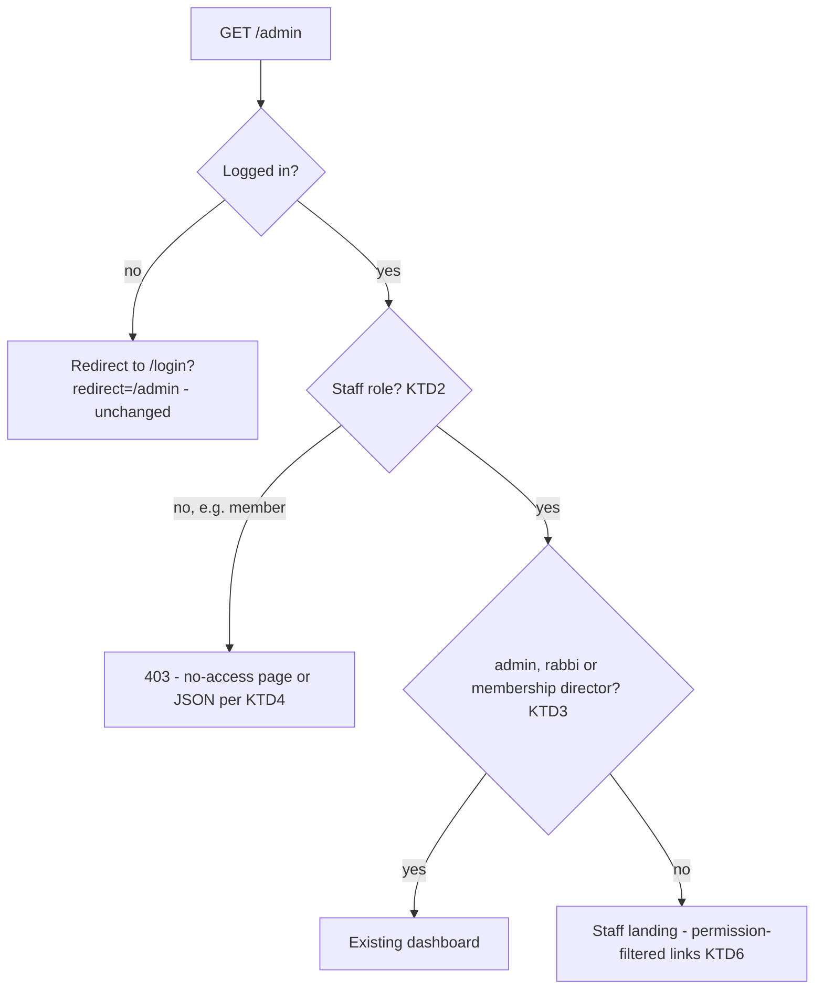
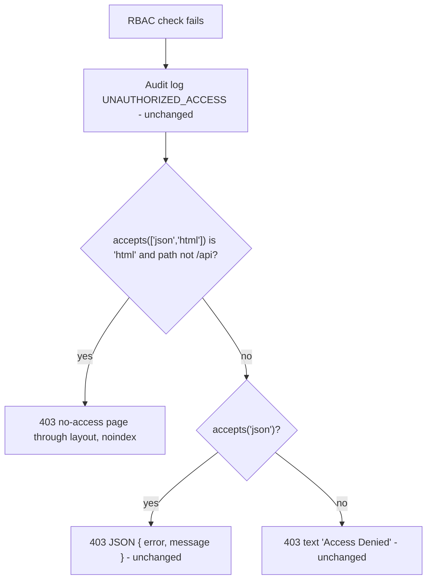

# Staff Admin Access - Plan

## Goal Capsule

- **Objective:** Every staff account on the temple site (admin, rabbi, membership director, social chair, treasurer) can reach the admin screens its role allows by clicking through the site. No staff account sees admin data its role excludes. Anyone who opens an admin page they can't use sees a readable page instead of a raw error.
- **Means:** `/admin` becomes role-aware: the existing dashboard for admin, rabbi and membership director, and a permission-filtered landing page for the other staff roles (KTD1, KTD3). The permission middleware gains a browser-only "no access" page (KTD4).
- **Authority:** the user's request, then Product Contract requirements (R-IDs), then Key Technical Decisions (KTD-IDs), then Implementation Units. On product behavior the R wins; on mechanism the KTD wins.
- **Stop conditions:** stop and ask before changing any role's permissions in `src/config/roles-permissions.js`. Also stop if a change would alter the JSON 403 body `{ error, message }` that scripts and API callers receive.
- **Execution profile:** one PR into `dev`, three units (U1, U2, U3). U2 is test-first.
- **Who finishes:** the implementer builds, tests and opens the PR; the repo owner reviews and merges.

---

## Product Contract

### Summary

Show an Admin link to every staff role and make `/admin` serve each role something it can use. Admin, rabbi and membership director keep the full dashboard. Social chair and treasurer get a short page listing only the screens their permissions allow. Logged-in users who hit an admin page their role can't use, in a browser, get a site page explaining they don't have access instead of a JSON error.

### Problem Frame

The site defines five staff roles with real admin permissions, but only admin and rabbi are shown a way in. The nav's Admin link is hardcoded to those two roles (`src/views/layout.ejs`). The dashboard at `/admin` admits only admin, rabbi and membership director (`src/routes/admin/dashboard.js`).

A social chair who wants to edit a calendar event has no link to `/admin/calendar`, even though that page works for them. If they try `/admin`, the browser shows `{"error":"Access Denied","message":"This resource requires one of: admin, rabbi, membership_director"}`. The treasurer has the same problem with `/admin/donations`. Every admin screen's "Back to dashboard" link points at `/admin`, so these roles get that same JSON error from inside pages they are allowed to use. The membership director can open the dashboard but has no nav link to it.

Opening the full dashboard to every staff role is not safe. It shows this month's donation total, the new-member count and an Audit Logs link to anyone it admits (`src/views/admin/dashboard.ejs`), and the social chair role is meant to have no access to donations (PRD FR27). Today's demo walks through each staff account, so these dead ends are visible to the audience.

### Key Decisions

- **Social chair and treasurer get a limited landing page, not the dashboard.** (session-settled: user-approved — chosen over opening the full dashboard with sections hidden per role: the dashboard shows donation totals and audit logs to everyone it admits, so hiding them role by role means reworking a screen admins rely on.) Governs R2, R4.
- **Browser requests that are denied get a site page; scripts and API callers keep the JSON error.** (session-settled: user-approved — chosen over leaving the raw JSON error for every request: staff now click into admin pages from the nav, so a denial they can read matters.) Governs R5, R6.

### Requirements

**Finding the admin area**

- R1. Every staff account sees an Admin link in the site nav on every page. Members and logged-out visitors do not.
- R2. The Admin link and every admin "Back to dashboard" link open a page that works for the account. Admin, rabbi and membership director see the existing dashboard. Social chair and treasurer see a page listing only the admin screens their permissions allow.

**Keeping data within each role**

- R3. What each role may do is unchanged: no role gains or loses a permission or a screen it can open.
- R4. Social chair and treasurer never see the dashboard's metrics (donation total, new members, active chat, pending messages), the operator health panel, the live metrics feed, the audit logs or the email-queue retry. Those stay limited to admin, rabbi and membership director.

**When access is denied**

- R5. A logged-in user who opens an admin page their role can't use, in a browser, gets a 403 site page. It has the normal nav, says they don't have access, and links back: staff to `/admin`, everyone else to the homepage. It does not list which roles would be allowed.
- R6. Requests from the site's own scripts, and any request under `/api`, keep the current 403 response exactly: JSON `{ error: 'Access Denied', message }`, or plain text when JSON isn't acceptable. Logged-out users are still redirected to login as today.

### Acceptance Examples

- AE1. Covers R1, R2. Given the demo social chair is logged in, when they click Admin in the nav, then they see a page with links to Announcements, Calendar and Chat Moderation. Clicking Calendar then Edit opens the event form.
- AE2. Covers R2, R4. Given the treasurer is logged in, when they open `/admin`, then the only screen listed is Donations. No donation total, member count or Audit Logs link appears on that page.
- AE3. Covers R5. Given the social chair is logged in, when they type `/admin/donations` into the browser, then they see the "no access" page with the site nav and a link back to `/admin`, and the status is 403.
- AE4. Covers R6. Given the same social chair, when the announcements editor script posts to a donations endpoint, or a request asks `/admin/metrics.json` for JSON, then the response is the existing JSON 403 body.

### Success Criteria

- In today's demo, each staff demo account reaches its own screens by clicking from the nav, and no JSON error appears on screen for any of them.

### Scope Boundaries

- No new demo account. The seeder has no membership director; that role is covered by tests.
- No change to the dashboard's content for admin, rabbi or membership director, including the Rabbi-only tools card and onboarding tour.
- No change to session timeouts. `src/middleware/sessionTimeout.js` gives the treasurer the admin-tier timeout and the social chair and membership director the member tier; that is unrelated to navigation.
- The social chair's ability to create members-only calendar events (an accepted deviation from FR27, recorded in `_bmad-output/implementation-artifacts/deferred-work.md`) stays as is.
- Considered, not built: refreshing the nav when a role changes mid-session. The nav reads the role from the login token, so a demoted user may still see the Admin link until they log in again. The link then leads to the R5 page, which makes the mismatch visible and harmless. Revisit if roles start changing often for logged-in users.
- Considered, not built: moving RBAC denials onto the typed `AuthError` path and `src/middleware/errorHandler.js`. See KTD4.

---

## Planning Contract

### Key Technical Decisions

- KTD1. **Keep `/admin` as the one staff entry point and make its handler role-aware.** The alternative was a new staff URL. 19 admin views include `src/views/admin/partials/back-to-dashboard.ejs`, which links to `/admin`, so routing by role at `/admin` fixes the nav link, its active highlight and every back link at once (R2). Pages under `/admin` already skip the header data lookups and get `noindex` (`CHROME_SKIP_PREFIXES` and the `/admin` noindex rule in `src/server.js`).
- KTD2. **"Staff" means a role that holds at least one permission.** It is computed from `getRolePermissions(role)` in `src/config/roles-permissions.js`, so it matches exactly the five staff roles. It is exposed to views on `res.locals` next to the existing `hasPermission`. The nav (R1) and the `/admin` gate (R2) both use this one definition, so no role list is hardcoded in the layout.
- KTD3. **The full-dashboard choice stays a fixed role list: admin, rabbi, membership director.** A permission check such as `VIEW_METRICS` would demote the rabbi, who lacks it today but has always had the dashboard. The dashboard's other routes (`/metrics.json`, `/audit-logs`, `POST /email-queue/:id/retry`) keep that same three-role gate (R4). Only `GET /` widens to all staff, so the shared `requireAdminAccess` array in `src/routes/admin/dashboard.js` is split.
- KTD4. **The "no access" page is a branch inside `src/middleware/requireRbac.js`, not a handoff to the central error handler.**
  - The branch fires only when `req.accepts(['json', 'html'])` returns `'html'` and the path is not under `/api`. A browser's Accept header resolves to `'html'`. `*/*`, a missing header (scripts and supertest) and `application/json` resolve to `'json'`, so every existing JSON caller keeps today's response (R6).
  - `errorHandler.js`'s `wantsJson` would send HTML to `public/js/admin-announcements.js` and `public/js/page-editor.js`, which post JSON without an Accept header. It would also change the body to `{ success, message }`, which `admin-announcements.js` and `__tests__/integration/chatRoutes.test.js` read as `error`.
  - The five copied denial blocks become one private helper. It keeps the audit log call and the JSON and text responses byte-for-byte, and adds the HTML branch first. The `NODE_ENV === 'test'` escape hatches at the top of each factory stay untouched (AGENTS.md).
  - A new exported `requireStaff()` guard (KTD2's staff check) denies through the same helper. Its JSON message ("This resource requires a staff role") is new; only `GET /admin` uses it, and no script or `/api` caller requests that page, so R6 is unaffected.
- KTD5. **The 403 page renders through `layout`, not `error.ejs`.** `error.ejs` is a standalone document with no site nav, and R5 asks for the normal nav. The page passes `noindex: true` and a `title`, which the layout requires.
- KTD6. **The staff landing is a separate light handler, and its link list is shared with the dashboard.** It does no metric, backup or email-queue reads, which keeps it fast and keeps R4 data out of its render path. The dashboard's permission-gated "Manage" links (`src/views/admin/dashboard.ejs`) move into one partial used by both pages, so the two lists can't drift apart. The dashboard keeps its unconditional Audit Logs link outside that partial, because the dashboard is only reached by roles that may see it.

### High-Level Technical Design

`GET /admin` after the change:

How a denial is answered (all RBAC guards):

### Sources & Research

- `src/middleware/requireRbac.js`: `requireRole`, `requirePermission`, `requireAnyRole`, `requireAnyPermission` each carry a copy of the denial block. `requireAnyPermission` has two copies.
- `src/server.js`: the global JWT-decode middleware sets `res.locals.user`, `hasPermission` and `Permissions` on every request. `CHROME_SKIP_PREFIXES` and the `/admin` noindex rule follow it.
- `src/controllers/donationController.js`: the only existing 403 page render, through `error.ejs`.
- PRD `_bmad-output/planning-artifacts/prd.md`: Journey 7 (the social chair logs in to "a simplified admin interface (just announcements + public calendar)"), FR24 (treasurer and social chair log in to the admin interface), FR27 and FR27b.

---

## Implementation Units

### U1. Staff check and nav link

- **Goal:** every staff role sees the Admin link in the nav; members and visitors don't.
- **Requirements:** R1, R3. Implements KTD2.
- **Dependencies:** none.
- **Files:**
  - `src/config/roles-permissions.js`
  - `src/server.js`
  - `src/views/layout.ejs`
  - `__tests__/config/roles-permissions.test.js`
  - `__tests__/integration/staffNav.test.js` (new)
- **Approach:**
  1. Add and export a staff check next to `hasPermission`. It is true when the user's role maps to at least one permission, and false for a missing user, the member role or an unknown role.
  2. Expose it on `res.locals` in the same global middleware that sets `hasPermission`, reading `req.user` lazily the same way.
  3. Replace the `user.role === 'admin' || user.role === 'rabbi'` condition in the layout nav with the staff check.
- **Patterns to follow:** the existing `res.locals.hasPermission` closure in `src/server.js`; the signed-cookie request in `__tests__/integration/globalChrome.test.js`.
- **Test scenarios:**
  - The staff check is true for admin, rabbi, membership_director, social_chair and treasurer.
  - The staff check is false for member, for an unknown role string and for a null user.
  - A public page (`/`) requested with a signed social_chair cookie renders an `href="/admin"` nav link. Repeat for treasurer, membership_director, rabbi and admin.
  - The same page with a signed member cookie renders no `/admin` link.
  - The same page with no cookie renders no `/admin` link.
- **Verification:** the new nav tests pass. Logged in as the demo social chair, the Admin link shows on the homepage.

### U2. "No access" page for browser denials

- **Goal:** denied browser requests get a readable 403 page with the site nav, while scripts and API callers keep today's JSON.
- **Requirements:** R5, R6. Implements KTD4, KTD5.
- **Dependencies:** U1 (the page's back link uses the staff check).
- **Files:**
  - `src/middleware/requireRbac.js`
  - `src/views/forbidden.ejs` (new)
  - `__tests__/middleware/requireRbac.test.js`
  - `__tests__/integration/forbiddenPage.test.js` (new)
  - `__tests__/views/forbidden.accessibility.test.js` (new)
- **Approach:**
  1. Fold the five denial blocks into one private helper that takes the request, the response, the audit details and the JSON message.
  2. In the helper, render the 403 page through `layout` when KTD4's browser condition holds and `res.render` exists. Otherwise fall through to the unchanged JSON and text branches.
  3. The page shows a heading, one sentence and one link. Staff get "Back to admin" pointing at `/admin`; others get a link to the homepage. Required roles are not shown (R5).
  4. Add and export `requireStaff()`, which passes when the user's role is staff (U1's check) and otherwise denies through the helper (KTD4). Keep the same `NODE_ENV === 'test'` escape hatch shape as the other factories.
- **Execution note:** write the failing unit and integration cases for the HTML branch first. Then refactor the five blocks into the helper with the existing `requireRbac.test.js` assertions held green throughout.
- **Patterns to follow:** `respondWithError` in `src/middleware/sessionTimeout.js` for the "HTML unless `/api`" shape. Layout render calls in `src/controllers/adminController.js` (`title`, `bodyView`, `viewData`, `noindex`). The shared kit partials in `src/views/partials/` (`page-header`, `button` with `variant: 'navigational'`).
- **Test scenarios:**
  - Unit: a mock request whose `accepts` returns `'html'`, on a non-`/api` path, makes the helper render with status 403 and does not call `res.json`.
  - Unit: the existing cases (`accepts` returns true → `res.json({ error: 'Access Denied', ... })`; false → `res.send('Access Denied')`) still pass unchanged, including mock requests with no `originalUrl` and no `res.render`.
  - Unit: the audit log call still fires once per denial with the same action and entity type.
  - Integration: the social chair requests `/admin/donations` with a browser Accept header. The response is 403 HTML containing the no-access heading, the site nav and a link to `/admin`, and it does not contain "requires one of". Covers AE3.
  - Integration: the same request with no Accept header, and again with `Accept: application/json`, returns the JSON body with `error: 'Access Denied'`. Covers AE4.
  - Integration: a member requests `/admin/donations` with a browser Accept header. The 403 page links to the homepage, not `/admin`.
  - Integration: a browser-Accept request to an RBAC-guarded `/api` route (`/api/chat/message/:id/approve` as a member) returns JSON.
  - Integration: `__tests__/integration/chatRoutes.test.js` passes unmodified.
  - Unit: `requireStaff()` calls `next()` for each of the five staff roles and denies a member with status 403 through the same helper (JSON `error: 'Access Denied'` when JSON is acceptable).
  - Accessibility: the rendered 403 page passes jest-axe with the WCAG 2.1 AA tag set used by the other `*.accessibility.test.js` files.
- **Verification:** all RBAC, chat and CSRF-lane suites pass unmodified apart from the new cases. In a browser, the demo social chair opening `/admin/donations` sees the no-access page.

### U3. Role-aware `/admin` and the staff landing page

- **Goal:** `/admin` serves the full dashboard to admin, rabbi and membership director, and a permission-filtered landing to social chair and treasurer.
- **Requirements:** R2, R3, R4. Implements KTD1, KTD3, KTD6.
- **Dependencies:** U1 (staff check), U2 (members denied at `/admin` see the no-access page).
- **Files:**
  - `src/routes/admin/dashboard.js`
  - `src/controllers/adminController.js`
  - `src/views/admin/staff-home.ejs` (new)
  - `src/views/admin/partials/manage-links.ejs` (new)
  - `src/views/admin/dashboard.ejs`
  - `__tests__/integration/adminDashboardRoutes.test.js`
  - `__tests__/views/staffHome.accessibility.test.js` (new)
- **Approach:**
  1. Split the dashboard router's shared guard. `GET /` uses U2's `requireStaff()`. `/metrics.json`, `/audit-logs` and `POST /email-queue/:id/retry` keep the three-role gate (KTD3).
  2. In the `GET /` handler, choose using `req.user.role`, the role `requireAuth` reloads from the database, never `res.locals.user`, which holds the possibly stale token claim. Send admin, rabbi and membership director to the existing `getDashboard` unchanged. Send other staff to a new light handler that renders `admin/staff-home` through `layout` with only the user's role; neither `req.user` nor the login token carries a name, and the handler does no reads.
  3. Move the permission-gated Manage links from `dashboard.ejs` into `admin/partials/manage-links.ejs`. Include it from both pages; the dashboard keeps its Audit Logs link after the include (KTD6).
- **Patterns to follow:** `getDashboard` render options in `src/controllers/adminController.js` (stylesheet `/css/admin.css`). The service mocks and signed-token pattern at the top of `__tests__/integration/adminDashboardRoutes.test.js`: JWT with `token_version: 1`, and the mocked `db.query` row carrying the same role, because RBAC reads the role from the database and the layout reads it from the token.
- **Test scenarios:**
  - The social chair `GET /admin` returns 200 with links to `/admin/announcements`, `/admin/calendar` and `/admin/chat-moderation`, and none to `/admin/donations`, `/admin/members`, `/admin/messages` or `/admin/audit-logs`. Covers AE1.
  - The treasurer `GET /admin` returns 200 with a link to `/admin/donations` only. The body contains no `metric-donations`, `metric-new-members` or Audit Logs text. Covers AE2.
  - The staff landing makes no donation, user-count, backup or email-queue service calls (assert those mocks were not called).
  - Admin, rabbi and membership director `GET /admin` each return the full dashboard (`metric-donations` present). The Manage section still lists the same links as before this change for each of the three.
  - A member `GET /admin` returns 403.
  - A token claiming admin with a mocked database row of social_chair gets the staff landing, with no `metric-donations`.
  - The social chair and the treasurer each get 403 from `GET /admin/metrics.json`, `GET /admin/audit-logs` and `POST /admin/email-queue/:id/retry`.
  - The existing back-to-dashboard assertion (`<a href="/admin" class="back-to-dashboard">`) still passes.
  - Accessibility: the staff landing for social chair passes jest-axe with the shared WCAG 2.1 AA tag set.
- **Verification:** the dashboard suites pass. In a browser, the demo social chair goes Admin, then Calendar, then Edit on an event. The demo treasurer goes Admin, then Donations, then "Back to dashboard", and lands back on their page with no JSON error.

---

## Verification Contract

| Gate | Command or check | Proves |
|---|---|---|
| Full suite | `npm test` | All Jest suites green, coverage threshold held (60% global) |
| Targeted suites | `npx jest __tests__/middleware/requireRbac.test.js __tests__/integration/forbiddenPage.test.js __tests__/integration/staffNav.test.js __tests__/integration/adminDashboardRoutes.test.js __tests__/integration/chatRoutes.test.js` | U1–U3 behavior and the unchanged JSON contract |
| Accessibility | `npm run test:a11y` | New 403 page and staff landing meet WCAG 2.1 AA |
| Lint | `npm run lint` | `src/` clean |
| Manual demo walk | `npm run dev`, log in as each demo account (`DemoPass!2026`) | AE1–AE3 in a real browser, no console CSP errors |

---

## Definition of Done

- R1–R6 each have at least one passing test that names the behavior.
- U1, U2 and U3 meet their Verification lines.
- `__tests__/integration/chatRoutes.test.js` and the existing `__tests__/middleware/requireRbac.test.js` cases pass without edits to their assertions.
- No role's permission list in `src/config/roles-permissions.js` changed.
- No inline `<script>`, `<style>` or `style=` in the new views, and no `console.log` in `src/`.
- The `NODE_ENV === 'test'` branches in the RBAC and auth middleware are untouched.
- No leftover code from abandoned approaches remains in the diff.
